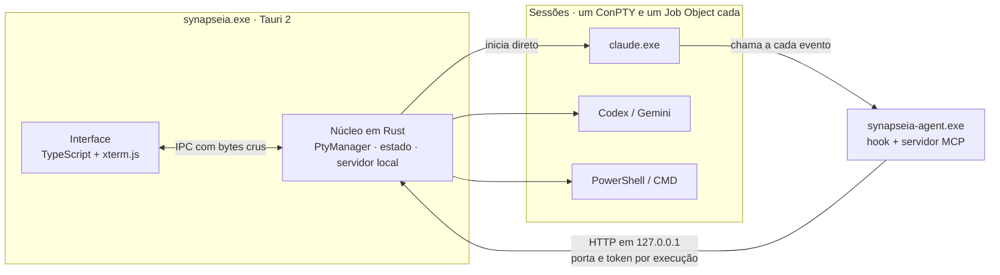

<div align="center">


# SynapseIA

**Terminais e agentes de IA lado a lado, numa janela só.**

Claude Code, Codex, Gemini, PowerShell, CMD e notas, com status ao vivo de cada um
e um canvas que mostra os agentes conversando entre si.


[](https://github.com/mar1nho/synapsesai/actions/workflows/ci.yml)

[O que é](#-o-que-é) ·
[O que faz](#-o-que-faz) ·
[Como funciona](#-como-funciona) ·
[Como rodar](#-como-rodar) ·
[Segurança](#-segurança) ·
[Licença](#-licença)

</div>

---

## 💡 O que é

Quem trabalha com vários agentes de IA ao mesmo tempo acaba com uma pilha de janelas de terminal e nenhuma ideia de qual delas está esperando resposta.

O **SynapseIA** é um app de desktop para Windows que resolve isso: cada agente ou terminal vira uma **sessão**, todas ficam numa lista em árvore com o status sempre visível, e até quatro aparecem lado a lado na tela. Quando um agente precisa de você e não está à vista, o Windows avisa.

Ele não é um "wrapper" de chat. Cada sessão é um terminal de verdade (ConPTY), rodando o CLI original do agente, do jeito que rodaria no Windows Terminal.

## ✨ O que faz

| | Recurso | Como é |
|---|---|---|
| 🖥️ | **Sessões de vários tipos** | Claude Code, Codex, Gemini, PowerShell, CMD e notas em Markdown |
| 🌳 | **Lista em árvore** | Agentes criados por outro agente aparecem como filhos de quem os criou |
| 🔲 | **Grade de 1 a 4 painéis** | Painéis redimensionáveis; o app nunca mostra mais painéis do que sessões |
| 🚦 | **Status ao vivo** | Executando, esperando você ou parado, em cada sessão da lista |
| 🔔 | **Aviso só quando importa** | Notificação do Windows apenas quando um agente espera você fora de vista; clicar abre a sessão |
| 🕸️ | **Canvas dos agentes** | Cards dos agentes, com linhas de quem criou quem e de quem falou com quem |
| 🤝 | **Agentes que criam agentes** | Um Claude pode criar outro pela ferramenta `criar_agente` e conversar com ele pelo nome |
| 📁 | **Painel de arquivos e editor** | Árvore da pasta da sessão em foco e editor com abas (CodeMirror 6) |
| 💾 | **Retoma de onde parou** | Ao reabrir, cada agente volta na conversa em que estava |
| 🧰 | **Tela Ambiente** | Verifica o que falta na máquina e instala num terminal visível: Git, Claude Code e fnm por `winget`; Node pelo fnm; Codex e Gemini pelo npm |
| 🎨 | **Três temas** | Marinho (azul-marinho, padrão), Escuro e Claro, com as cores do terminal acompanhando |
| 📌 | **Bandeja do sistema** | Fechar a janela só esconde o app; os agentes continuam trabalhando |

### Atalhos

| Atalho | Ação |
|---|---|
| <kbd>Ctrl</kbd> + <kbd>Shift</kbd> + <kbd>N</kbd> | Nova sessão |
| <kbd>Ctrl</kbd> + <kbd>Shift</kbd> + <kbd>1</kbd>…<kbd>4</kbd> | Foca o painel 1 a 4 |

Todos usam <kbd>Ctrl</kbd> + <kbd>Shift</kbd> para não colidir com os atalhos do próprio Claude Code.

## 🔧 Como funciona

São três tipos de processo:



**1. O app** (`synapseia.exe`) desenha a interface e gerencia as sessões. O Rust cuida dos pseudoconsoles; o WebView2 mostra um xterm.js por sessão, criado uma vez e movido entre os painéis, nunca recriado.

**2. Uma sessão por processo.** Cada agente roda no seu ConPTY, dentro de um Job Object do Windows: fechar a sessão encerra a árvore inteira de processos, sem deixar órfãos. A saída vai do terminal para a tela em lotes de 12 ms.

**3. O sidecar** (`synapseia-agent.exe`) é um executável pequeno que o próprio Claude Code chama, de duas formas: como *hook*, a cada evento, e como servidor MCP, que oferece a ferramenta `criar_agente`. Ele repassa tudo ao app por HTTP local.

### De onde vem o status

| Tipo de sessão | Como o app sabe o que ela está fazendo |
|---|---|
| Claude Code | Pelos hooks: cada evento vira `executando`, `esperando você` ou `parado` |
| Codex, Gemini, PowerShell, CMD | Pela atividade de saída do terminal |

### Conversa entre agentes

A conversa entre os Claudes é **nativa do Claude Code** (`ListAgents` e `SendMessage`, endereçados pelo nome da sessão). O SynapseIA não entrega mensagem nenhuma: ele só observa as chamadas pelo hook e desenha as linhas no canvas.

Quando um agente chama `criar_agente`, o app prepara uma pasta de trabalho para o filho em `<projeto>\.synapseia\<nome>\`, com as instruções dele, e abre a nova sessão sem tirar o foco do que você está olhando.

### Onde ficam os dados

| O quê | Onde |
|---|---|
| Sessões e layout | `%APPDATA%\SynapseIA\state.json` (escrita atômica) |
| Notas | `%APPDATA%\SynapseIA\notas\<id>.md` |
| Logs | `%APPDATA%\SynapseIA\logs\` |
| Pasta de cada agente filho | `<projeto>\.synapseia\<nome>\` |

O app **nunca escreve nos seus arquivos de configuração** (`~\.claude\settings.json`, `.mcp.json`, `~\.codex\config.toml`). A configuração dele vai por parâmetro, apontando para `%APPDATA%\SynapseIA\`.

## 🚀 Como rodar

### Requisitos

- Windows 10 ou 11
- [Rust](https://rustup.rs) (toolchain MSVC) e [Node.js](https://nodejs.org), para compilar
- [Git for Windows](https://git-scm.com/download/win) e [Claude Code](https://claude.com/claude-code), para usar
- Codex e Gemini são opcionais e dependem do Node (pelo `fnm`)

### Passo a passo

```powershell
git clone https://github.com/mar1nho/synapsesai.git
cd synapsesai

npm install
npm run tauri dev        # roda o app (compila o sidecar antes)
npm run tauri build      # gera o instalador (.exe)
```

A primeira compilação do Rust leva cerca de 12 minutos. As seguintes são incrementais.

### Testes

```powershell
npx tsc --noEmit                                               # tipos do frontend
npm test                                                       # frontend (Vitest)
cargo test --manifest-path src-tauri/Cargo.toml --lib          # app (unidade)
cargo test --manifest-path src-tauri/Cargo.toml --test pty_it  # integração com ConPTY real
cargo test --manifest-path src-tauri/agent/Cargo.toml          # sidecar
```

## 📂 Estrutura

```text
src/                  frontend em TypeScript puro, sem framework
├─ state/             estado central e lógica pura, com testes ao lado
├─ ui/                interface: lista, painéis, canvas, arquivos, editor
├─ terminal/          TermHost: um xterm.js por sessão
└─ styles/            temas e variáveis de cor

src-tauri/            app em Rust
├─ src/pty/           ConPTY, lotes de saída e Job Objects
├─ src/control/       servidor local e leitura dos hooks
├─ src/launch.rs      monta o comando de cada tipo de sessão
├─ src/spawn.rs       prepara a pasta dos agentes filhos
└─ agent/             sidecar synapseia-agent (hook + MCP)
```

A arquitetura completa e as convenções do projeto estão em [`CLAUDE.md`](CLAUDE.md).

## 🔒 Segurança

- **Sem conexões externas.** O único servidor é local (`127.0.0.1`), com porta e token novos a cada execução.
- **Não inicia com o Windows** e **não pede elevação**.
- **Sem comando escondido.** Os agentes são iniciados direto, com os argumentos em texto: nada de PowerShell codificado, `Invoke-Expression` ou script baixado e executado. Há testes automatizados que garantem isso.
- **Não guarda senha nem token.** O login de cada CLI é feito por você, no próprio terminal.
- **A interface tem CSP**, e todo texto dinâmico é escapado antes de ir para a tela.

> [!WARNING]
> Os agentes de IA rodam como processos filhos do app e executam comandos na sua máquina. Com a opção "bypass" ligada, fazem isso sem pedir confirmação. Use-a só em pastas em que você confia.

## 📄 Licença

Distribuído sob a licença [MIT](LICENSE).

---

<div align="center">

Feito com Tauri 2, Rust e TypeScript.

</div>
